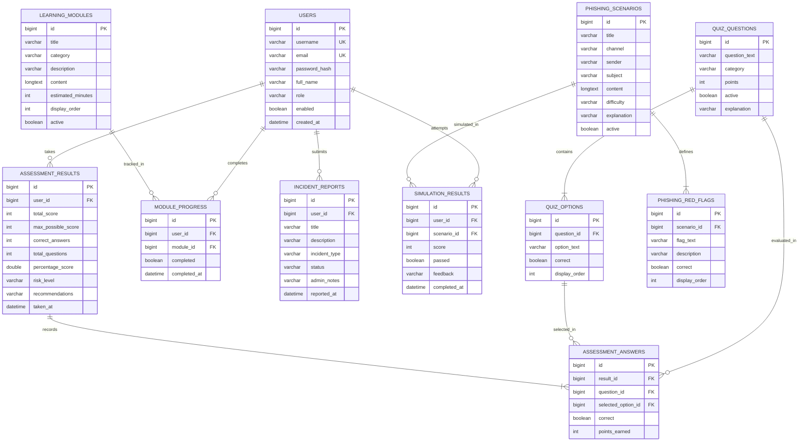

# Privacy Guard — Database Entity Relationship (ER) Diagram

This document illustrates the relational database structure for **Privacy Guard**, mapping all 11 JPA entities directly to their MySQL tables.

---

## 1. Visual Entity-Relationship Diagram

---

## 2. Key Entity Descriptions

1. **`USERS`**: Core identity table storing user credentials, BCrypt hashes, account status (`enabled`), and authorization roles (`USER`, `ADMIN`).
2. **`QUIZ_QUESTIONS` & `QUIZ_OPTIONS`**: The privacy questionnaire catalog. Each question contains at least 2 options, with exactly one designated as correct.
3. **`ASSESSMENT_RESULTS` & `ASSESSMENT_ANSWERS`**: Track quiz attempts. Results record total scores, percentages, and risk classifications (`LOW`, `MEDIUM`, `HIGH`, `CRITICAL`). Answers record the specific choice submitted for each question and the points awarded.
4. **`LEARNING_MODULES` & `MODULE_PROGRESS`**: Structured educational articles categorized by threat topic. `MODULE_PROGRESS` maintains a unique constraint on `(user_id, module_id)` ensuring accurate completion tracking.
5. **`INCIDENT_REPORTS`**: User-submitted security incident reports. Supports status transitions (`OPEN` -> `UNDER_REVIEW` -> `RESOLVED` / `DISMISSED`) and administrator triage notes.
6. **`PHISHING_SCENARIOS`, `PHISHING_RED_FLAGS` & `SIMULATION_RESULTS`**: Realistic social engineering exercises across email, SMS, and direct messages. Users earn points by identifying genuine red flags without selecting deceptive distractors.

---

## 3. Referential Integrity & Deletion Policies

- **Cascading User Deletion**: Deleting a user account cascades to all assessment results, answers, incident reports, module progress, and simulation records.
- **Relational Protection for Questions**: A quiz question cannot be hard-deleted if it is referenced in past `ASSESSMENT_ANSWERS`. The application rejects deletion with HTTP 400 Bad Request, directing the administrator to deactivate the question instead to protect student history.
- **Relational Protection for Modules**: A learning module cannot be hard-deleted if users have recorded completion progress in `MODULE_PROGRESS`. The application rejects deletion with HTTP 400 Bad Request, advising administrators to toggle it inactive instead.
