# Privacy Guard — Database Entity Relationship (ER) Diagram

This document specifies the exact relational database structure for **Privacy Guard — Social Media Privacy Awareness and Security Management System**, mapped 1-to-1 from JPA entities to MySQL 8 tables.

---

## Mermaid Entity-Relationship Diagram

```mermaid
erDiagram
    USERS ||--o{ ASSESSMENT_RESULTS : "takes"
    USERS ||--o{ MODULE_PROGRESS : "completes"
    USERS ||--o{ INCIDENT_REPORTS : "files"
    USERS ||--o{ SIMULATION_RESULTS : "attempts"

    QUIZ_QUESTIONS ||--|{ QUIZ_OPTIONS : "contains"
    QUIZ_QUESTIONS ||--o{ ASSESSMENT_ANSWERS : "evaluated_in"
    QUIZ_OPTIONS ||--o{ ASSESSMENT_ANSWERS : "selected_in"

    ASSESSMENT_RESULTS ||--|{ ASSESSMENT_ANSWERS : "comprises"

    LEARNING_MODULES ||--o{ MODULE_PROGRESS : "tracked_in"

    PHISHING_SCENARIOS ||--|{ PHISHING_RED_FLAGS : "has"
    PHISHING_SCENARIOS ||--o{ SIMULATION_RESULTS : "simulated_in"

    USERS {
        bigint id PK "Auto-Increment"
        varchar username UK "Unique (3-50 chars)"
        varchar email UK "Unique (valid email)"
        varchar password_hash "BCrypt 12 rounds"
        varchar full_name "Display name"
        varchar role "USER | ADMIN"
        boolean enabled "Account status flag"
        datetime created_at "Audit timestamp"
        datetime updated_at "Audit timestamp"
    }

    QUIZ_QUESTIONS {
        bigint id PK "Auto-Increment"
        text question_text "Diagnostic prompt"
        varchar category "PHISHING, PASSWORD_SAFETY, etc."
        int points "Default 10 points"
        boolean active "Learner visibility toggle"
        text explanation "Educational rationale"
    }

    QUIZ_OPTIONS {
        bigint id PK "Auto-Increment"
        bigint question_id FK "References QUIZ_QUESTIONS(id)"
        varchar option_text "Choice description"
        boolean is_correct "Single correct indicator"
        int display_order "Sequencing 1..N"
    }

    ASSESSMENT_RESULTS {
        bigint id PK "Auto-Increment"
        bigint user_id FK "References USERS(id)"
        int total_score "Total points earned"
        int max_possible_score "Max potential points (e.g. 150)"
        int correct_answers "Count of correct answers"
        int total_questions "Questions evaluated (e.g. 15)"
        varchar risk_level "LOW | MEDIUM | HIGH | CRITICAL"
        text recommendations "Dynamic remediation guidance"
        datetime taken_at "Submission timestamp"
    }

    ASSESSMENT_ANSWERS {
        bigint id PK "Auto-Increment"
        bigint assessment_result_id FK "References ASSESSMENT_RESULTS(id)"
        bigint question_id FK "References QUIZ_QUESTIONS(id)"
        bigint selected_option_id FK "References QUIZ_OPTIONS(id)"
        boolean correct "Evaluated outcome"
        int points_earned "Points awarded (0 or question.points)"
    }

    LEARNING_MODULES {
        bigint id PK "Auto-Increment"
        varchar title "Module headline"
        varchar category "Privacy category"
        text description "Curriculum synopsis"
        longtext content "HTML educational content"
        int estimated_minutes "Reading time"
        int display_order "Catalog sequence"
        boolean active "Catalog visibility toggle"
        datetime created_at "Audit timestamp"
        datetime updated_at "Audit timestamp"
    }

    MODULE_PROGRESS {
        bigint id PK "Auto-Increment"
        bigint user_id FK "References USERS(id)"
        bigint module_id FK "References LEARNING_MODULES(id)"
        boolean completed "Completion status"
        datetime completed_at "Completion timestamp"
    }

    INCIDENT_REPORTS {
        bigint id PK "Auto-Increment"
        bigint user_id FK "References USERS(id)"
        varchar incident_type "PHISHING_ATTEMPT, COMPROMISE, etc."
        varchar title "Report summary title"
        text description "Detailed incident narrative"
        varchar platform "Social network platform name"
        varchar status "OPEN | UNDER_REVIEW | RESOLVED | DISMISSED"
        text admin_notes "Investigator resolution notes"
        datetime reported_at "Filing timestamp"
        datetime updated_at "Status change timestamp"
    }

    PHISHING_SCENARIOS {
        bigint id PK "Auto-Increment"
        varchar title "Scenario scenario name"
        varchar channel "EMAIL | SMS | DIRECT_MESSAGE"
        varchar sender "Sender address or profile handle"
        varchar subject "Subject line if email"
        text content "HTML or text message payload"
        varchar difficulty "BEGINNER | INTERMEDIATE | ADVANCED"
        text explanation "Debriefing guide"
        boolean active "Simulator toggle"
    }

    PHISHING_RED_FLAGS {
        bigint id PK "Auto-Increment"
        bigint scenario_id FK "References PHISHING_SCENARIOS(id)"
        varchar flag_text "Indicator statement"
        text description "Why indicator matters"
        boolean correct "True indicator vs. distractor"
        int display_order "Sequencing 1..N"
    }

    SIMULATION_RESULTS {
        bigint id PK "Auto-Increment"
        bigint user_id FK "References USERS(id)"
        bigint scenario_id FK "References PHISHING_SCENARIOS(id)"
        int score "Earned score percentage"
        int total_possible_flags "Actual true indicators"
        int flags_identified "Correctly flagged indicators"
        int false_positives "Distractors erroneously chosen"
        boolean passed "Evaluation status (score >= 70)"
        text feedback "Performance debrief"
        datetime taken_at "Simulation timestamp"
    }
```

---

## Referential Integrity & Deletion Safeguards

1. **Question Deletion Policy**:
   - `QUIZ_QUESTIONS` is protected by relational checks. If a question is referenced in `ASSESSMENT_ANSWERS`, a hard `DELETE` is blocked by the application with HTTP 400 (`BadRequestException`) to protect the integrity of historical assessment scores. Administrators are directed to toggle `active = false` instead.
2. **Learning Module Deletion Policy**:
   - `LEARNING_MODULES` is protected by `MODULE_PROGRESS` checks. Hard deletion of modules with existing learner progress is blocked with HTTP 400. Deactivation (`active = false`) is used to archive older curricula without corrupting user profile statistics.
3. **User Deletion Policy**:
   - Deleting a user account cascades to their associated assessment results, module progress, incident reports, and simulation outcomes in compliance with data privacy erasure standards.
