# Privacy Guard — System Architecture

This document describes the end-to-end multi-tiered software architecture of **Privacy Guard — Social Media Privacy Awareness and Security Management System**.

---

## High-Level Architecture Diagram

```mermaid
graph TB
    subgraph Client Tier ["Client Tier (Browser)"]
        UI_User["User Views<br/>• index.html (Landing)<br/>• login.html / register.html<br/>• dashboard.html (Analytics & Recs)<br/>• quiz.html (Diagnostic Assessment)<br/>• learning.html (Curricula)<br/>• password-checker.html (Zxcvbn)<br/>• simulator.html (Phishing Lab)<br/>• incidents.html (Reporting)"]
        UI_Admin["Admin Operations<br/>• admin.html (Single Page Ops)<br/>- System Intelligence Charts<br/>- User Access Governance<br/>- Incident Audit & CSV/PDF Export<br/>- Quiz Question Management<br/>- Learning Module Management"]
        JS_App["Shared JS Runtime<br/>• app.js (API Client, CSRF, Toast, Modals)<br/>• Chart.js 4.4 (Canvas Visualizations)"]
    end

    subgraph Security Tier ["Security & Gateway Tier (Spring Security 6)"]
        CSRF["CookieCsrfTokenRepository<br/>(XSRF-TOKEN / Double Submit)"]
        SecFilter["SecurityFilterChain<br/>• /api/auth/** (Public)<br/>• /api/admin/** (ROLE_ADMIN)<br/>• /api/** (ROLE_USER / ROLE_ADMIN)"]
        AccountFilter["UserAccountStatusFilter<br/>(Revokes Deleted/Disabled Sessions)"]
        AuthMgr["AuthenticationManager & DaoAuthenticationProvider<br/>(BCrypt 12 Rounds)"]
        UserDetailsService["CustomUserDetailsService"]
    end

    subgraph Application Tier ["Application & Service Tier (Spring Boot 3.2.5)"]
        AuthCtrl["AuthController<br/>• /api/auth/register<br/>• /api/auth/login<br/>• /api/auth/change-password<br/>• /api/auth/me"]
        DashCtrl["DashboardController<br/>• /api/dashboard<br/>• /api/dashboard/categories<br/>• /api/dashboard/trend"]
        AdminCtrl["AdminController<br/>• /api/admin/summary<br/>• /api/admin/analytics<br/>• /api/admin/users/**<br/>• /api/admin/incidents/**<br/>• /api/admin/incidents/export/**<br/>• /api/admin/questions/**<br/>• /api/admin/modules/**"]
        QuizCtrl["QuizController<br/>• /api/quiz/questions<br/>• /api/quiz/submit<br/>• /api/quiz/history"]
        IncCtrl["IncidentController<br/>• /api/incidents"]
        SimCtrl["SimulationController<br/>• /api/simulation/**"]
        LearnCtrl["LearningController<br/>• /api/learning/**"]

        UserService["UserService<br/>(Auth, Profiles, Governance, BCrypt)"]
        DashService["DashboardService<br/>(Real DB Analytics & Targeted Recs)"]
        QuizService["QuizService<br/>(Pedagogical Awareness Scoring)"]
        IncService["IncidentService<br/>(Reporting, Formula Escaping, OpenPDF)"]
        SimService["SimulationService<br/>(Lure Evaluation & Debriefing)"]
        LearnService["LearningService<br/>(Curriculum & Progress)"]
    end

    subgraph Persistence Tier ["Persistence Tier (Spring Data JPA / Hibernate 6)"]
        UserRepo["UserRepository"]
        QuizRepo["QuizQuestionRepository<br/>& QuizOptionRepository<br/>& AssessmentAnswerRepository"]
        ResultRepo["AssessmentResultRepository"]
        IncRepo["IncidentReportRepository"]
        ModRepo["LearningModuleRepository<br/>& ModuleProgressRepository"]
        SimRepo["PhishingScenarioRepository<br/>& PhishingRedFlagRepository<br/>& SimulationResultRepository"]
    end

    subgraph Database Tier ["Data Tier (MySQL 8)"]
        MySQL[("MySQL 8 Database<br/>`privacy_awareness_db`<br/>InnoDB Engine / UTF-8MB4")]
    end

    UI_User --> JS_App
    UI_Admin --> JS_App
    JS_App -->|HTTP Fetch / JSON| CSRF
    CSRF --> SecFilter
    SecFilter --> AccountFilter
    AccountFilter --> AuthMgr
    AuthMgr --> UserDetailsService

    SecFilter --> AuthCtrl
    SecFilter --> DashCtrl
    SecFilter --> AdminCtrl
    SecFilter --> QuizCtrl
    SecFilter --> IncCtrl
    SecFilter --> SimCtrl
    SecFilter --> LearnCtrl

    AuthCtrl --> UserService
    DashCtrl --> DashService
    AdminCtrl --> UserService
    AdminCtrl --> DashService
    AdminCtrl --> IncService
    AdminCtrl --> QuizRepo
    AdminCtrl --> ModRepo
    QuizCtrl --> QuizService
    IncCtrl --> IncService
    SimCtrl --> SimService
    LearnCtrl --> LearnService

    UserService --> UserRepo
    DashService --> UserRepo
    DashService --> ResultRepo
    DashService --> IncRepo
    DashService --> ModRepo
    DashService --> SimRepo
    QuizService --> QuizRepo
    QuizService --> ResultRepo
    IncService --> IncRepo
    SimService --> SimRepo
    LearnService --> ModRepo

    UserRepo --> MySQL
    QuizRepo --> MySQL
    ResultRepo --> MySQL
    IncRepo --> MySQL
    ModRepo --> MySQL
    SimRepo --> MySQL
```

---

## Security In-Depth Controls

1. **Authentication & Session Lifecycle**:
   - HTTP session cookies configured with `SameSite` and `XSRF-TOKEN` protection.
   - `UserAccountStatusFilter` runs on every request: if an account is disabled or deleted from MySQL, the active session is immediately invalidated, SecurityContext cleared, and HTTP 401 returned.
2. **Access Governance**:
   - Explicit role-based authorization: `/admin.html` and `/api/admin/**` require `ROLE_ADMIN`.
   - Admin account deletion and password changes do not recreate zombie credentials on restarts unless explicitly invoked via `ADMIN_RECOVER=true`.
3. **Data Integrity & Export Defense**:
   - CSV export features built-in formula injection shielding (`=`, `+`, `-`, `@`, `\t`, `\r` prefixes neutralised).
   - PDF export uses OpenPDF with explicit column allocation and status summaries.
   - Cascading foreign key safeguards prevent deleting quiz questions or learning modules that have historical user participation.
