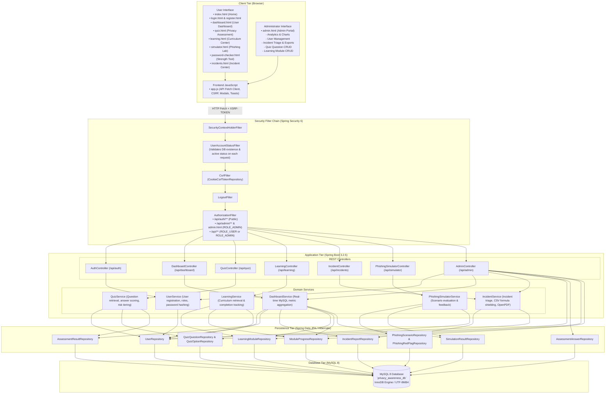

# Privacy Guard — System Architecture

This document describes the multi-tiered software architecture of **Privacy Guard — Social Media Privacy Awareness and Security Management System**, explaining the request lifecycle, security filters, backend layers, and database integration.

---

## 1. System Architecture Diagram

---

## 2. Request Lifecycle & Layer Breakdown

### 2.1 Client Tier (Browser)
- **Structure:** Static HTML5 pages styled with custom, dark-theme CSS (`style.css`).
- **Communication:** `app.js` issues asynchronous `fetch()` calls exchanging JSON payloads with the backend.
- **CSRF Token Handling:** On page load, `app.js` extracts the `XSRF-TOKEN` cookie issued by Spring Security and includes it as the `X-XSRF-TOKEN` header on every `POST`, `PUT`, `PATCH`, and `DELETE` request.

### 2.2 Security & Gateway Tier (Spring Security 6)
Every incoming HTTP request passes through the configured `SecurityFilterChain`:
1. **`SecurityContextHolderFilter`**: Restores the user's `Authentication` object from the current `HttpSession`.
2. **`UserAccountStatusFilter`**: Queries MySQL to verify that the authenticated account has not been deleted or disabled (`enabled == false`). If the account is deactivated or missing, it immediately invalidates the session and returns HTTP 401 Unauthorized.
3. **`CsrfFilter`**: Validates the `X-XSRF-TOKEN` header on mutating requests.
4. **`AuthorizationFilter`**: Enforces URL-level permissions:
   - `/api/auth/register` and `/api/auth/login`: Publicly accessible.
   - `/api/admin/**` and `admin.html`: Strictly requires `ROLE_ADMIN`.
   - `/api/**`: Requires an authenticated session (`ROLE_USER` or `ROLE_ADMIN`).

### 2.3 Application & Domain Service Tier (Spring Boot 3.2.5)
- **Controllers:** Map REST endpoints, deserialize incoming JSON into validated Request DTOs, invoke business services, and return Response DTOs.
- **Services:** Contain core domain logic:
  - **`UserService`**: Handles user registration, profile retrieval, password modification with BCrypt verification, and user management.
  - **`QuizService`**: Retrieves active diagnostic questions, calculates assessment points and percentage scores, determines risk tiers, and generates targeted study recommendations.
  - **`DashboardService`**: Aggregates real-time relational counts across assessments, incidents, learning progress, and phishing simulations for user and administrative views.
  - **`IncidentService`**: Manages incident report submissions, status workflows, CSV exports with spreadsheet formula injection protection, and OpenPDF report generation.
  - **`PhishingSimulatorService`**: Evaluates student selections against known attack red flags and distractors.
  - **`LearningService`**: Tracks user completion state per educational module.

### 2.4 Persistence Tier (Spring Data JPA / Hibernate)
- Entities map directly to MySQL tables with relational annotations (`@OneToMany`, `@ManyToOne`, `@JoinColumn`).
- Repositories extend `JpaRepository`, providing query methods and transaction management (`@Transactional`).

### 2.5 Data Tier (MySQL 8)
- Stores all data in `privacy_awareness_db` using the InnoDB engine with `utf8mb4_unicode_ci` encoding.
- Foreign key constraints enforce relational integrity.
